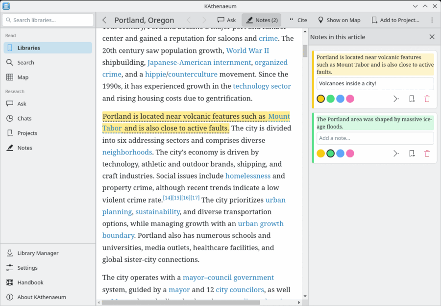

<!--
SPDX-FileCopyrightText: 2026 Jaimie Garner <pacificnm@gmail.com>
SPDX-License-Identifier: CC0-1.0
-->

# KAthenaeum

**A private, offline Wikipedia library with an AI research assistant, as a native KDE application for laptops.**

KAthenaeum is the KDE / Qt version of [Athenaeum](https://github.com/pacificnm/Athenaeum). It turns [Kiwix](https://www.kiwix.org) ZIM files into a searchable library on your own desktop. Ask a question and get an answer written by a small local language model, with every sentence linked back to the Wikipedia article it came from. Nothing leaves your machine: no cloud API, no account, no tracking.

There is nothing to build before you can use a library: it is searchable and ready to answer questions the moment its download finishes.



> **Status:** in development, version 0.17. Everything below works; the project is preparing to apply to join KDE.

## Features

- **Read** articles from any Wikipedia ZIM, rendered cleanly with their pictures, following the Plasma colour scheme (light and dark), with a contents menu and back/forward. Links to the web open in your browser.
- **Search** every library at once, or one: titles as you type, then the text of every article through the ZIMs' own word indexes, with the matching passage shown. An article the search names ranks first.
- **Classroom**: an AI teacher for whatever you want to learn. Give it your name, the grade you have completed and what you enjoy; choose one of ten core subjects or your own topic, a level (kindergarten to adult) and a length, and it plans a course of units and lessons. Every lesson reads real articles from your libraries, chosen because they are about it (a lesson nothing is about is left out, not made up), with an introduction written for you: the main idea, key words, questions to read with. A reading opens with the lesson beside it, so its questions stay in view while you highlight and cite. Keep a course in a research project and its readings, introductions and your highlights collect there, each marked with its lesson. Each lesson has a quiz and each unit a test, written from the readings with every answer checked against its passage, graded with the right answer and where it is in the reading; the course page shows scores and what to review. "Ask Your Teacher" on a lesson is a tutor that answers from the readings and guides you to the answer rather than giving it. Tells you which library to get when a subject has none.
- **Ask** questions in plain language. Answers stream in, each sentence carries a citation computed by the app (not trusted to the model) that opens the article at the cited section, and sentences the sources do not support, or figures none of them contain, are flagged for checking. Facts from articles' infoboxes (boiling points, dates of birth) are read too. Ask follow-up questions ("and its density?"), or stop an answer at any time. A question the libraries cannot answer gets "I could not find it", not an answer from the model's memory.
- **Browse** each library from its home page: find an article by title, A to Z, Random article, recently read, and Wikipedia's own overview articles ("Outline of …", "List of …", "Timeline of …"). All read straight from the ZIM, nothing to build.
- **Chat history**: every chat is saved with its sources and citations, and can be reopened, renamed or deleted.
- **Research projects**: collect articles, passages you select in them, answers and chats, each with your notes. A project's own chat answers from just that material (or the whole library too, kept apart), with the project's goal in mind. Write Markdown documents in Kate's editor, with a live preview, that cite the project's sources, and export a document or the whole project to `.md`. Let the AI draft a summary of the project's articles, notes from a chat, or a report written to your own instructions ("a full report on how Crater Lake formed: the eruption first, then the caldera… formal tone"): it plans the sections, writes each from the sources that fit it (the project's, and the whole library if you like), and KAthenaeum adds the citations, a reference list and "[?]" on anything to check.
- **Ask about this article**: a chat panel beside every article that answers from that article alone, citing its sections (a click scrolls there). Select text and right-click to ask about it. These chats are saved with their article.
- **Highlights and notes**: select a passage and highlight it in yellow, green, blue or pink, with a note if you like. An article's notes open in a panel beside it; the Notes page gathers them all by article, to search, export, or turn into a project document. Passages saved to a project are marked in their article too.
- **Citations**: cite any article in MLA (9th), APA (7th) or Chicago (17th) style, copied with its italics. A Wikipedia article is cited as the Wikipedia page it copies, with its address, as read in a dated offline copy. Each project has a bibliography, and documents get a works-cited list in your style when exported (or where you insert it).
- **Timelines**: an article's or a project's dated sentences in date order, grouped by period, each opening its article; read from the text (full dates, BC and AD, decades, centuries, "years ago"), not written by the model. Keep one in a project or export it.
- **Dictionary**: select a word, right-click, Define: its meaning, pronunciation and an example from an installed Wiktionary (the 31 MB Simple English one, or the full one). "Molecules" leads to "molecule".
- **Maps**: download the world overview and the countries, states or regions you want (in Settings), then browse them offline. Click a city, a building, a park or a lake to see what it is and open its Wikipedia article from your libraries; OpenStreetMap's own link to the article is used when it has one, so "Portland" opens "Portland, Oregon". Also lists what the place is in (its park, town, county), and finds places by name. An article about a place has "Show on Map", from OpenStreetMap's link or the article's own coordinates.
- **Library manager**: browse the Kiwix catalog (also offline, from a saved copy), download with progress, cancel and resume, verify every download, spot newer versions, add a ZIM file you already have, see each library's details, choose the download folder, remove safely.
- **Models**: see whether Ollama is running and has the models, switch the answer or embedding model without restarting, and get told (with the fix) when Ollama is set to unload one model to load the other.

The library manager and model settings are ordinary parts of the application, not a separate admin interface, and there is no login: it is your desktop.

## Help

The KAthenaeum Handbook (`doc/`) opens in KDE's Help Center, from "Handbook" in the sidebar or F1, and is listed there under Application Manuals › Education.

## How it works

```
KDE / Qt UI  -->  ZIM files via libzim (C++)   (article text, images, title and word search)
     |
     +--------->  Ollama on this machine       (embeddings and the answer model)
     +--------->  SQLite                       (chats, projects, excerpts, notes, settings, map places)
     +--------->  MapLibre                     (maps cut from Protomaps' OpenStreetMap build, one file per region)
```

An answer is made in four steps: **find** the best articles through the ZIM's own indexes, **read** their best passages (ranked by meaning with a small embedding model) with a small local answer model, **cite** by matching each answer sentence to the passages by embedding similarity, and **check** for figures or topics the sources do not contain. With the default models on a laptop iGPU, the first words appear after about 5 seconds and a whole answer takes 9 to 19.

## Privacy

KAthenaeum has no account, no telemetry and no hosted AI service. Questions, chats, notes and projects stay in one SQLite file in your home folder. It connects to the internet only for these, and only over https:

- the Kiwix catalog (`opds.library.kiwix.org`), when the Library Manager is open, when you check for updates, and once a week if update checks are on (Settings);
- library downloads from Kiwix's mirrors, when you start one;
- map downloads from Protomaps (`build.protomaps.com`) and Geofabrik (`download.geofabrik.de`), when you add a region.

Ollama is reached at the address set in Settings (`http://localhost:11434` by default).

## Requirements

| | |
|---|---|
| Desktop | KDE Plasma 6 (other Linux desktops work with the Qt and KDE libraries installed) |
| Libraries | Qt 6.8, KDE Frameworks 6.13, Kirigami, Kirigami Addons, libzim 9, libxml2, SQLite, MapLibre Native for Qt |
| [Ollama](https://ollama.com) | Installed on the same machine, with a small answer model (default `qwen3.5:2b`) and an embedding model (`nomic-embed-text`). Without it, reading and searching still work. |
| aria2 | `aria2c`, for downloading libraries |
| GPU | Not required. Built for laptop iGPUs and small models. |

## Installing and building

There are no release packages yet. To build KAthenaeum, and a `.deb` for Debian, see [HACKING.md](HACKING.md). Ollama is not packaged by Debian: install it from [ollama.com](https://ollama.com).

## Contributing and reporting bugs

Report bugs and ideas at [GitHub issues](https://github.com/pacificnm/KAthenaeum/issues). Contributions are welcome: [HACKING.md](HACKING.md) explains how the code is organised, how to test, and the rules changes must follow.

## Relationship to Athenaeum

Athenaeum is the web version: a FastAPI server with a React UI and a PostgreSQL + pgvector index, meant to run on a home server with a GPU. KAthenaeum is the desktop version of the same idea without the index, built on Athenaeum's "ZIM search" mode and its citation design, both measured and tested there.

## License

KAthenaeum is free software, released under the [GNU General Public License v3.0 or later](LICENSES/GPL-3.0-or-later.txt). The handbook is under CC BY-SA 4.0, and the bundled map assets and MapLibre under their own licences; `REUSE.toml` and `data/copyright` say which applies to what. Wikipedia text and images in ZIM files have their own licences (mostly CC BY-SA 4.0); map data is © OpenStreetMap contributors (ODbL).
